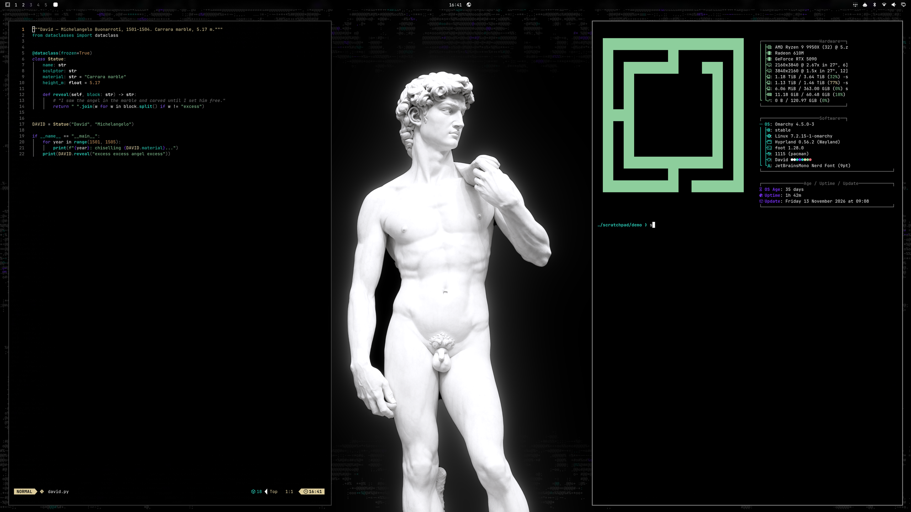

# David

An Omarchy theme: Michelangelo's David glowing white on pure black, with optional
wallpapers that frame him in a faint ASCII Rococo border with coloured characters woven in.



```
omarchy theme install https://github.com/arkmpm/omarchy-david-theme
```

- **Chrome:** pure black, white text, grey 2px square borders (Vantablack geometry)
- **Accents:** teal `#2dd4bf` and purple `#7b31fc`
- **Wallpapers** (3840x2160, in selector order):
  1. David on pure black (default)
  2. With the ASCII Rococo frame, teal and purple characters
  3. Frame with teal, purple and pink characters
  4. Frame with pink characters only
- **Icons:** Yaru prussian green
- **btop:** CPU/GPU graph runs purple at the base, teal at the top

The David wallpaper was generated locally with Qwen-Image 2.1 and the Rococo ornament with
Z-Image Turbo, then composited at 3840x2160 with ImageMagick.
